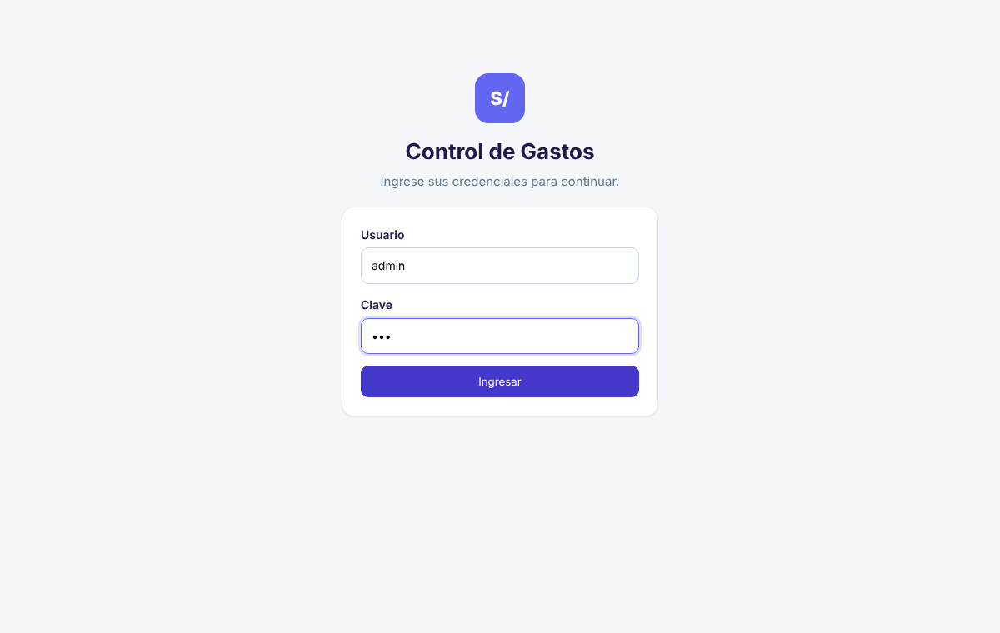
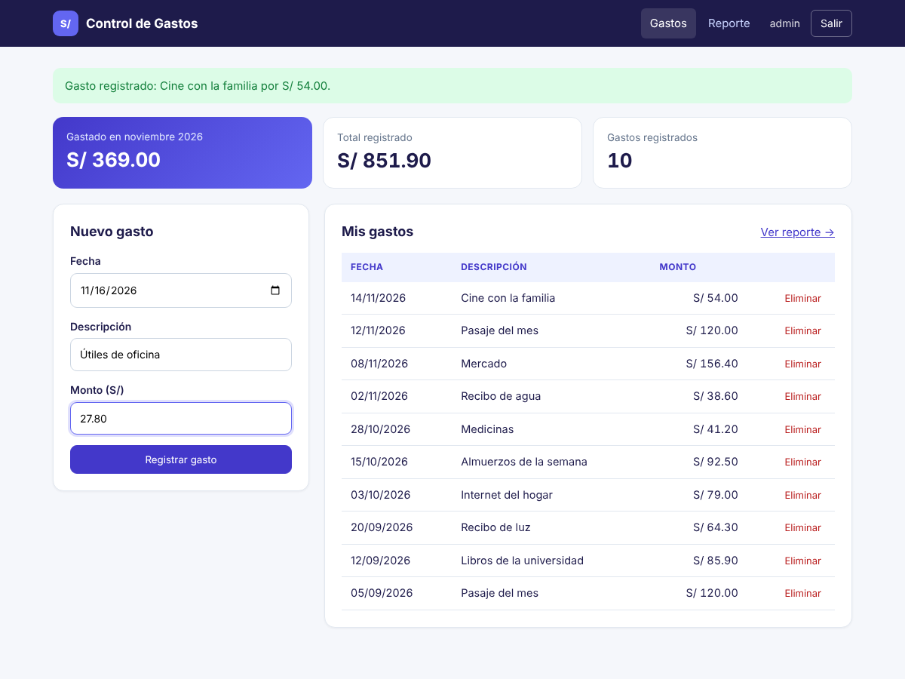
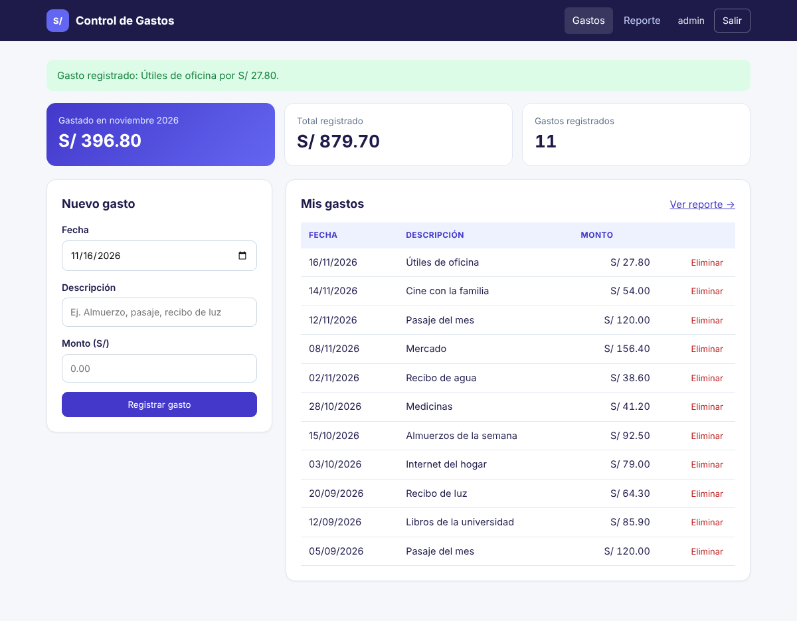
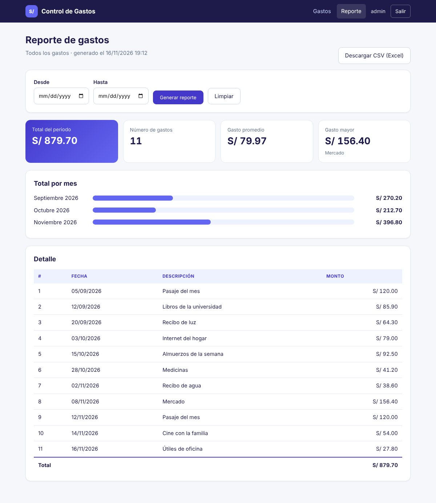
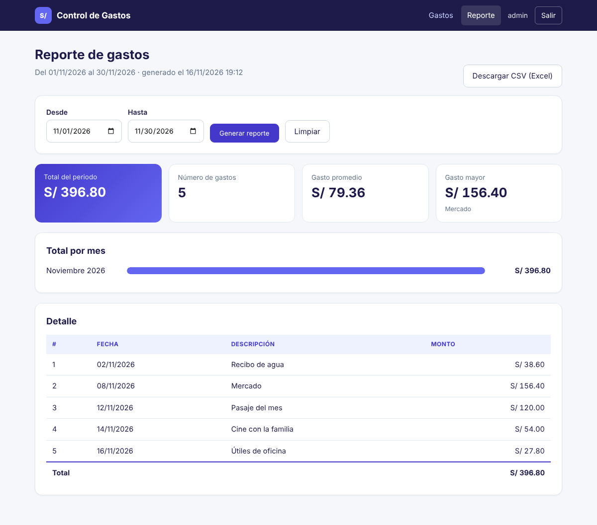
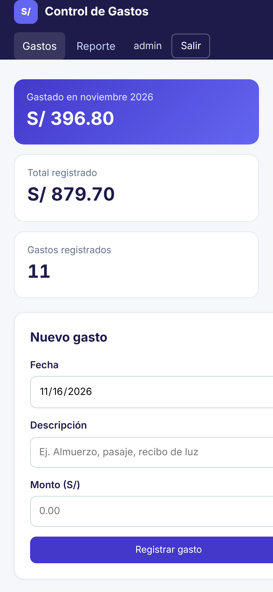

# 💰 Control de Gastos — Flask + SQLite

Aplicación web para **registrar gastos personales** (fecha, descripción y monto) y **generar reportes**,
desarrollada con **Python**, **Flask** y **SQLite**. El acceso está protegido con usuario y clave.

| | |
|---|---|
| **Usuario** | `admin` |
| **Clave** | `123` |

---

## 📸 Capturas

### 1. Acceso
La aplicación pide usuario y clave antes de mostrar cualquier dato.



### 2. Registro de un gasto
Se completa la fecha, la descripción y el monto, y se pulsa **Registrar gasto**.



### 3. Lista de gastos
El gasto aparece en la lista, ordenada del más reciente al más antiguo. En la parte superior
se ven el gasto del mes actual, el total registrado y el número de gastos. Cada gasto se puede eliminar.



### 4. Reporte general
Muestra el total, el número de gastos, el gasto promedio y el gasto mayor; un gráfico con el **total por mes**
y el detalle de todos los gastos con su total.



### 5. Reporte por rango de fechas
Con los campos **Desde** y **Hasta** se genera el reporte de un periodo (en la captura, noviembre de 2026).
El botón **Descargar CSV (Excel)** exporta el mismo reporte para abrirlo en Excel.



### 6. Vista en celular
La interfaz se adapta a pantallas pequeñas.



---

## ⚙️ Funcionamiento

1. **Acceso (`/`)**: el usuario ingresa `admin` y `123`. La clave se valida con `check_password_hash`
   contra el hash guardado en SQLite (la clave **no** se guarda en texto plano). Si es correcta,
   se crea la sesión; si no, se muestra «Usuario o clave incorrectos».
2. **Gastos (`/gastos`)**: formulario para registrar un gasto. El servidor valida que:
   - la fecha sea válida y no sea futura;
   - la descripción tenga al menos 3 caracteres;
   - el monto sea un número mayor que 0, con hasta 2 decimales.

   Si todo es correcto, el gasto se guarda en la tabla `gasto` y aparece en la lista.
3. **Reporte (`/reporte`)**: calcula el total, el promedio, el gasto mayor y el total por mes.
   Se puede filtrar por rango de fechas y descargar en CSV (`/reporte.csv`).
4. **Salir**: el botón **Salir** cierra la sesión. Todas las páginas internas redirigen al acceso
   si no hay una sesión iniciada.

### Base de datos (SQLite · `gastos.db`)

```sql
CREATE TABLE usuario (
    id            INTEGER PRIMARY KEY AUTOINCREMENT,
    usuario       TEXT NOT NULL UNIQUE,
    password_hash TEXT NOT NULL
);

CREATE TABLE gasto (
    id          INTEGER PRIMARY KEY AUTOINCREMENT,
    fecha       TEXT NOT NULL,              -- AAAA-MM-DD
    descripcion TEXT NOT NULL,
    monto       REAL NOT NULL CHECK (monto > 0),
    creado_en   TEXT NOT NULL
);
```

La base se crea automáticamente la primera vez que se ejecuta la aplicación, junto con el usuario `admin`.

---

## 🚀 Instalación y ejecución

Requisitos: **Python 3.10 o superior**.

```bash
git clone https://github.com/<tu-usuario>/gastos-flask.git
cd gastos-flask
pip install -r requirements.txt
python app.py
```

Abrir **http://127.0.0.1:5057** e ingresar con `admin` / `123`.

> Si el puerto 5057 está ocupado, se puede usar otro: `PORT=5080 python app.py` (en Windows: `set PORT=5080 && python app.py`).

---

## 📁 Estructura del proyecto

```
gastos-flask/
├── app.py               # Rutas, acceso, validaciones, reporte y base de datos
├── requirements.txt
├── static/css/estilos.css
├── templates/
│   ├── base.html        # Plantilla base con el menú
│   ├── login.html       # Acceso
│   ├── gastos.html      # Registro y lista de gastos
│   ├── reporte.html     # Reporte con filtros y totales
│   └── error.html
└── capturas/            # Imágenes de este README
```

## 🔒 Seguridad

- Clave guardada como hash (`generate_password_hash` de Werkzeug).
- Consultas SQL con parámetros (`?`) para evitar la inyección SQL; Jinja2 escapa el HTML.
- Token CSRF en todos los formularios y rutas internas protegidas con sesión.

> **Nota:** la clave `123` es la solicitada para esta práctica. En un uso real debe cambiarse por una clave segura.

---

**Tecnologías:** Python · Flask · SQLite · Jinja2 · HTML · CSS
